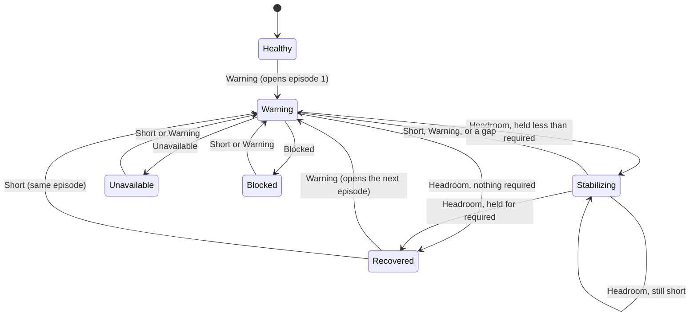
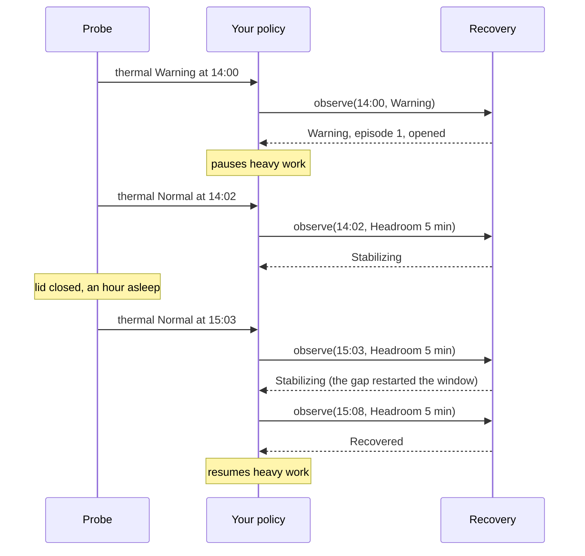

# vitals-machines

> Below the threshold is not the same as recovered. 🩺

Host vital signs and a recovery machine for Rust. Probe the machine you are running on: power source and batteries, CPU temperatures and OS thermal pressure, free space on the paths you actually use. Decide with your own thresholds whether that is a warning. Then feed the verdicts to a `Recovery`, and it tells you when the warning is really over: not the moment a reading crosses back, but once it has stayed on the safe side, without a gap, for as long as you asked. No threads, no polling, no clock of its own.

## Quick Start

```bash
cargo add vitals-machines --features probe
```

```rust
use core::time::Duration;
use vitals_machines::{Phase, Recovery, Refusal, Sample};

let s = Duration::from_secs;
let mut recovery = Recovery::new(s(60)); // a silence longer than 60 s breaks continuity
let cooled = Sample::Headroom { required: s(60) };

// No episode: only a warning moves the machine.
assert_eq!(recovery.observe(s(0), Sample::Short).map(|o| o.phase), Ok(Phase::Healthy));

let opened = recovery.observe(s(10), Sample::Warning);
assert_eq!(opened.map(|o| o.opened), Ok(true));

// Headroom must hold, continuously, for the required span.
let phase = |r: &mut Recovery, at| r.observe(s(at), cooled).map(|o| o.phase);
assert_eq!(phase(&mut recovery, 40), Ok(Phase::Stabilizing));
assert_eq!(phase(&mut recovery, 200), Ok(Phase::Stabilizing)); // a 160 s gap restarts it
assert_eq!(phase(&mut recovery, 230), Ok(Phase::Stabilizing));
assert_eq!(phase(&mut recovery, 260), Ok(Phase::Recovered));

assert_eq!(recovery.observe(s(1), Sample::Warning), Err(Refusal::TimeRegression));
```

One machine, one verb: `observe(now, sample)`. Time is a `Duration` since an epoch you pick, from a clock that only goes forward. The core is allocation-free `no_std` with no `unsafe`; the probes are the `probe` feature. Rust only, no gem.

## A Message to the Resistance

So your build agent runs on a laptop, and one afternoon the fans scream, the CPU throttles to a third of its speed, and the forty-minute build takes two hours and fails a timing test. You add a check: if the OS reports thermal pressure, pause the queue. Good.

Then the queue starts flapping. The laptop cools for ten seconds, the check says fine, the queue resumes, the CPU heats up again, the check says hot, the queue pauses. Your dashboard draws a comb. So you add a cooldown: resume only after it has been fine for five minutes. Then someone closes the lid in the middle of a warning, opens it an hour later, and your cooldown, which counted the hour asleep as an hour of being fine, resumes everything at once on a machine that is still hot.

And on the Linux box the OS thermal state is always "unknown", and your check reads unknown as fine.

What you wanted was a small, boring piece of bookkeeping: a warning opens an episode, the episode stays open until the vitals have held on the safe side for a span you choose, a silence nobody watched does not count as holding, and a reading nobody could take is not a good reading. That is this crate. It takes the readings. It does not decide what is too hot.

## Chapter 1: Stardate 2026.321, the AMS Santorio

> **AMS Santorio**, NCC-4238, *Santorio*-class vitals tender.
> The tender takes the crew's pulse. It signs nobody back on duty until the pulse has stayed steady.

Santorio Santorio put a scale on the thermometer and a pendulum to the pulse, then weighed himself, his meals and everything that left him for thirty years before drawing conclusions. The tender keeps his habits. Every watch it reads the engine room's temperatures, the charge in the batteries and the free space in the holds, and writes down what it could not read as unread. When the engine room runs hot it opens an entry in the sick-bay log. The entry stays open until the readings have been good for a full watch, and a watch nobody stood does not count.

On a bridge somewhere, a cadet volunteers:

```rust,ignore
fn may_resume(vitals: &Vitals) -> bool {
    vitals.cpu_celsius < 90.0 // and if there is no reading, it was probably fine
}
```

"That," says the tender's surgeon, "is discharging a patient because the fever dipped while you were looking at the thermometer."

## The Flight Plan

The machine is in one of six phases:



`Unavailable` and `Blocked` are reachable from every phase but `Healthy`, and `Headroom` leads out of them as it leads out of `Warning`. A gap (a silence longer than `max_gap`) restarts the window wherever it was.

And one hot afternoon on a build agent:



## How the Tender Works

### Samples

The machine never sees a temperature or a percentage. Your policy turns fresh readings into one of five verdicts:

| `Sample` | Means |
| --- | --- |
| `Warning` | A threshold fires now. |
| `Short` | Nothing fires, but an outstanding condition is still inside its recovery margin: below 10% battery is a warning, 10 to 20% is short. |
| `Headroom { required }` | Every outstanding condition is past its margin; it must stay there for `required`. |
| `Unavailable` | The readings an outstanding condition depends on could not be taken. |
| `Blocked` | An outstanding condition's recovery target cannot be reached as configured (a margin above 100% charge). |

`required` is per sample, so a thermal episode can ask for five minutes while a charger plugged in counts at once. With no episode open, every sample but `Warning` stays `Healthy`: nothing has been wrong yet. A threshold with a separate recovery margin per condition is `feedback_machines::Hysteresis`.

### The window

```rust
use core::time::Duration;
use vitals_machines::{Phase, Recovery, Sample};

let s = Duration::from_secs;
let mut recovery = Recovery::new(s(60));
let cooled = Sample::Headroom { required: s(300) };
let phase = |r: &mut Recovery, at, sample| r.observe(s(at), sample).map(|o| o.phase);

assert_eq!(phase(&mut recovery, 0, Sample::Warning), Ok(Phase::Warning));
assert_eq!(phase(&mut recovery, 30, cooled), Ok(Phase::Stabilizing)); // the window starts
assert_eq!(phase(&mut recovery, 60, Sample::Short), Ok(Phase::Warning)); // and is gone
assert_eq!(phase(&mut recovery, 90, cooled), Ok(Phase::Stabilizing)); // starts again
assert_eq!(recovery.stable_for(), Some(Duration::ZERO));
assert_eq!(phase(&mut recovery, 150, cooled), Ok(Phase::Stabilizing));
assert_eq!(recovery.stable_for(), Some(s(60)));
```

The window is a `feedback_machines::Dwell`. Every sample but `Headroom` clears it. A silence longer than `max_gap` between two observations restarts it: the host may have slept, and nobody was watching. The first `Headroom` after a restart has held for zero.

Feed it a clock that keeps counting while the host is suspended (`CLOCK_BOOTTIME` on Linux, `mach_continuous_time` on macOS). `std::time::Instant` stops during sleep on some platforms, and then an hour asleep looks like no gap at all.

### Episodes

```rust
use core::time::Duration;
use vitals_machines::{Phase, Recovery, Sample};

let s = Duration::from_secs;
let mut recovery = Recovery::with_scope(7, s(60));
let quick = Sample::Headroom { required: Duration::ZERO };

let first = recovery.observe(s(0), Sample::Warning).map(|o| o.episode);
recovery.observe(s(1), quick).ok();
assert_eq!(recovery.phase(), Phase::Recovered);

// Slipping back inside the margin is still the same episode.
assert_eq!(recovery.observe(s(2), Sample::Short).map(|o| o.episode), first);

// A new warning after a recovery opens the next one.
let next = recovery.observe(s(3), Sample::Warning);
assert_eq!(next.map(|o| o.opened), Ok(true));
assert_ne!(recovery.episode(), first.ok().flatten());
```

An episode runs from the warning that opened it to the next warning after it recovered. `Observed::opened` says when a new one began, so you can reset whatever you track per episode. Each `Episode` is issued by a `periscope_machines::Issuer` in the recovery's scope and never reissued: tie per-episode work such as a checkpoint to its `Episode`, and a slow write cannot land on a newer one. `Episode::raw` is the id as an integer.

### Time only moves forward

```rust
use core::time::Duration;
use vitals_machines::{Recovery, Refusal, Sample};

let s = Duration::from_secs;
let mut recovery = Recovery::new(s(60));
recovery.observe(s(10), Sample::Short).ok(); // no episode: nothing recorded
recovery.observe(s(5), Sample::Warning).ok(); // so this is not a regression
let before = recovery.clone();
assert_eq!(recovery.observe(s(4), Sample::Short), Err(Refusal::TimeRegression));
assert_eq!(recovery, before);
```

Observations inside an episode, and the warning that opens one, record `now`. With no episode open, any other sample answers `Healthy` whatever the time and records nothing. A refused observation changes nothing.

### What each call answers

| Call | Honoured | Records `now` | Refused, nothing changed |
| --- | --- | --- | --- |
| `observe(now, sample)` | an `Observed`: `phase`, `episode`, `opened` | inside an episode, and on the warning that opens one | `TimeRegression`, `Exhausted` |
| `phase()`, `episode()`, `unresolved()` | the current phase, episode, and whether one is open and not recovered | never: a query | never refuses |
| `stable_for()` | how long headroom has held, `None` with no window running | never: a query | never refuses |
| `last_observed()`, `max_gap()` | the latest recorded instant, the configured gap | never: a query | never refuses |
| `reset()` | nothing: back to `Healthy` with no episode and no recorded instant; the next warning gets a fresh id | clears it | never refuses |
| `last_issued()` | the episode issued last, current or not | never: a query | never refuses |

`Exhausted` means the recovery's scope has issued its last episode id.

### Constructors

| Constructor | Builds |
| --- | --- |
| `Recovery::new(max_gap)` | scope zero, nothing issued |
| `Recovery::with_scope(scope, max_gap)` | `scope`, nothing issued |
| `Recovery::restored(scope, max_gap, last)` | `scope`, issuing after the raw id `last` (from `last_issued()`); `None` when `last` is not an id of `scope` |

Each starts `Healthy` with nothing observed. Persist `last_issued().map(Episode::raw)` and restore from it so a restart never reissues an episode:

```rust
use core::time::Duration;
use vitals_machines::{Episode, Recovery, Sample};

let s = Duration::from_secs;
let mut recovery = Recovery::with_scope(7, s(60));
recovery.observe(s(0), Sample::Warning).ok();
let saved = recovery.last_issued().map(Episode::raw);

let Some(mut resumed) = Recovery::restored(7, s(60), saved) else {
    panic!("saved is an id of scope 7");
};
resumed.observe(s(0), Sample::Warning).ok();
assert!(resumed.episode().map(Episode::raw) > saved);
assert_eq!(Recovery::restored(8, s(60), saved), None);
```

### Taking vitals

The `probe` feature reads the host. Every call is a fresh, synchronous, best-effort observation: run it on a blocking worker in async code.

```rust,no_run
# #[cfg(feature = "probe")]
# fn main() {
use std::time::{Duration, Instant};
use vitals_machines::probe::{BatteryKind, MachineSnapshot, ThermalState, inspect_machine};
use vitals_machines::{Phase, Recovery, Sample};

// Your policy: pause under thermal pressure or below 10% battery,
// resume after five minutes cool and above 20%.
fn sample(vitals: &MachineSnapshot) -> Sample {
    if matches!(vitals.thermal.state, ThermalState::Warning | ThermalState::Critical) {
        return Sample::Warning;
    }
    let charge = vitals.power.batteries.iter().flatten()
        .filter(|battery| battery.kind == BatteryKind::System)
        .filter_map(|battery| battery.charge_percent)
        .min();
    let headroom = Sample::Headroom { required: Duration::from_secs(300) };
    match (vitals.power.on_battery_power(), charge) {
        (Some(false), _) => headroom,
        (Some(true), Some(charge)) if charge < 10 => Sample::Warning,
        (Some(true), Some(charge)) if charge < 20 => Sample::Short,
        (Some(true), Some(_)) => headroom,
        _ => Sample::Unavailable,
    }
}

let start = Instant::now(); // stops during sleep on some platforms; see The window
let mut recovery = Recovery::new(Duration::from_secs(60));
loop {
    let vitals = inspect_machine();
    if let Ok(observed) = recovery.observe(start.elapsed(), sample(&vitals)) {
        let allowed = matches!(observed.phase, Phase::Healthy | Phase::Recovered);
        println!("heavy work allowed: {allowed}"); // pause or resume your workers
    }
    std::thread::sleep(Duration::from_secs(30));
}
# }
# #[cfg(not(feature = "probe"))]
# fn main() {}
```

- **`inspect_machine()`** answers model, form factor, displays, session hints (SSH, graphical), execution environment (container, VM), power and thermals. On FreeBSD, `profile.freebsd_acpi` adds the driver's lid states and video-output activity: hints, not proof of lid position or attached displays.
- **`inspect_storage(&[StorageTarget])`** probes only the paths you pass. Each resolves through symlinks to its filesystem; a future output probes its nearest existing ancestor. Paths sharing a filesystem and read-only view are grouped, free space is never summed across disks, and a probe failure is not zero free space.
- **`inspect_indexing(workspace)`** reports Spotlight on the workspace's volume and known indexer processes.

| | Linux | macOS | FreeBSD |
| --- | --- | --- | --- |
| Form factor | SMBIOS chassis; system-battery fallback | Model identifier; system-battery fallback | Loader SMBIOS chassis (`kenv`); system-battery fallback |
| Power | sysfs power supplies | `pmset -g batt`, two-second bound | `/dev/acpi` per-battery ioctls, `hw.acpi.acline` |
| Displays | DRM connector status | CoreGraphics online display list | DRM connector status (`/dev/dri/card*`) |
| CPU temperature | hwmon (`coretemp`, `k10temp`, `k8temp`, `via_cputemp`) and CPU thermal zones | Unavailable | CPU temperature and Tjmax sysctls |
| OS thermal state | Unknown | IOPM warnings, `NSProcessInfo` pressure | ACPI thermal-zone flags |
| Storage | `statvfs` / `statfs` | `statvfs` / `statfs` | `statvfs` / `statfs` |
| Indexing | Tracker/LocalSearch, Baloo, `updatedb` processes | `mdutil -s`, Spotlight processes | Linux's list plus `recollindex`, `locate.code`/`locate.bigram`, confirmed by `KERN_PROC_PATHNAME` |

## The Rules of the Tender

- **Samples, not readings.** The recovery machine sees verdicts. What is too hot, too empty or too full is your policy.
- **Absence of a warning is not recovery.** An episode is `Recovered` only after `Headroom` held continuously for `required`.
- **A silence nobody watched is not holding.** A gap longer than `max_gap` restarts the window.
- **Unknown is not false.** A missing, faulted, unreadable or implausible reading is unknown, never cool, charged or empty. `PowerInfo::on_battery_power()` answers `None` when the source is unknown, and a dead battery on external power is not on battery. Batteries stay separate; no system percentage is invented by averaging.
- **Independent facts.** Chassis, displays, session and power source are separate. A headless laptop on external power is valid; a missing battery does not make a desktop. Known containers and jails do not report the host's chassis, displays, batteries or thermals as their own.
- **Thermals are what the OS says.** CPU channels keep their OS identifier, label, source, kind and the driver's critical limit; they are never averaged. AMD Tctl is `control`, not die temperature. macOS reports thermal pressure, not Celsius, and its IOPM levels are not ordered numerically (0 normal, 100 danger, 10 crisis).
- **Probes never change anything.** Absolute executable paths, the C locale, no shell, no sudo, bounded output, a one-second deadline per command; a timed-out child is killed and reaped. No settings, services or indexes are touched.
- **Refusals don't panic.** `TimeRegression` and `Exhausted` are answers, and a refused observation leaves the machine equal to a clone taken before the call. `Phase`, `Sample` and `Refusal` are exhaustive: a new variant is a breaking change.

## What You Think You're Doing vs Reality

### You Think: "The OS says thermal state normal, so the machine is cool."
### Reality: The OS says it is not currently throttling you.

On macOS, "nominal" is also the answer on hardware that does not report thermal pressure at all; only a successful IOPM reading of normal establishes `Normal`. On Linux there is no OS thermal state, and every machine answers `Unknown`. On FreeBSD, `Normal` needs every ACPI thermal zone to clear its warning flags and have a working sensor and trip point. If your policy needs Celsius, read the CPU channels, and decide what an empty list means before the first hot afternoon.

### You Think: "Recovered means the problem is solved."
### Reality: Recovered means the readings held for as long as you asked.

The laptop that cooled down for five minutes while idle will heat up again the moment you resume the build. The tender tells you the fever broke. Whether the patient can run a marathon today is your call, and resuming at half the parallelism is a perfectly good answer.

### You Think: "`backing: other` means my output is on a real disk."
### Reality: It means the filesystem was not recognised as RAM-backed.

A temporary directory, a container layer and a RAM-backed block device can all answer `other` and still disappear. Free space is a fact about this instant, not a reservation.

## What's Yours

This is a pre-1.0 core; breaking changes land in minor versions. It is not a monitoring daemon. You own the clock, the loop that probes and how often, the thresholds and margins that turn readings into samples, and everything a phase triggers: pausing work, notifying someone, saving a checkpoint. The recovery machine lives in your process and forgets everything when the process does. Probes see the host and mount namespace you run in, not a remote target, and are best-effort: they are not proof that every sensor was found or that cooling is safe. No Windows, no private macOS interfaces, no privileged subprocesses, no driver loading.

## License

MIT License. See [LICENSE.txt](LICENSE.txt) for details.

**Remember: the fever broke while you were watching. That is not the same as well.**
